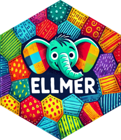

# 0 - Welcome

## Hi! 👋

:::: {layout-ncol="2" style="text-align: center;"}
<div>

{width="300px" height="300px" style="border-radius: 50%; object-fit: cover;"}

**Nic Crane**<br>Instructor

</div>

<div>

{width="300px" height="300px" style="border-radius: 50%; object-fit: cover;"}

**Yanina Bellini Saibene**<br>TA

</div>
::::

## What we'll learn

1. **Welcome and setup** - we're here!
2. Getting started with LLMs in R
3. Prompt engineering for more predictable results

**BREAK**

4. Extracting structured data from unstructured text
5. Using LLMs to call R functions via *tools*

## Format

📖 Explanations
<br/><br/>
🎥 Demos
<br/><br/>
✏️ Exercises
<br/><br/>
Have fun and experiment!

## Housekeeping

❓ Please ask questions
<br/><br/>
🙋 Yani is here to help with the exercises
<br/><br/>
🐢 Tell me to slow down if needed!

## Say hi to your neighbours 👋

We won't go around the room, but take a couple of minutes to introduce yourself to the people next to you:

- Your name and what you work on
- What you've already tried LLMs for, and whether it worked!

```{r}
#| echo: false
#| eval: true
countdown::countdown(minutes = 3)
```

## Quick show of hands 🙋

- Who has used ChatGPT, Claude, Gemini or similar in a browser?
- Who has used an LLM from R or another programming language?
- Who has used ellmer before?

## Working on Posit Cloud

- <https://posit.cloud/>
- Or your own laptop

## Code/examples

- <https://thisisnic.github.io/ellmer-latinr/>
- One script per section in `code/`

## How do we work with LLMs? APIs!

- Need an API key
- You should have received one today
- If you haven't, let us know!

# 1 - Getting Started with LLMs in R

## Learning objectives

By the end of this section you'll be able to:

- Set up an API key and connect to an LLM from R
- Hold a multi-turn conversation, and understand why earlier messages affect later answers
- See what a chat object contains, and how many tokens you're using
- Start a fresh chat when you need to

## Setting up your API key

-   Grab the API key you were sent!
-   Next we'll save it in `.Renviron` so we can use it

## Editing your .Renviron

Open your `.Renviron` file

```{r}
usethis::edit_r_environ()
```

## Editing your .Renviron

Save your API key at the bottom of the file like this:
<br/><br/>
```
OPENROUTER_API_KEY=sk12345567890
```
<br/>
*Important: After saving, restart R for the key to take effect.*

## The ellmer R package

{fig-align="center" height="400px"}

- work with LLMs in R
- handles all API calling for you

<https://ellmer.tidyverse.org/>

## ellmer: the foundation of the R AI ecosystem

ellmer handles talking to the models. A growing set of packages build on it:

- **{shinychat}** - chat interfaces in Shiny
- **{querychat}** - ask questions of your data in plain English
- **{mall}** - run LLM prompts over data frame columns
- **{ragnar}** - retrieval-augmented generation
- **{vitals}** - evaluate LLM output
- **{btw}** - describe your R session to an LLM
- **{mcptools}** - connect R to MCP tools and agents

Learn ellmer and the rest of the ecosystem opens up.

## Providers and models

| Provider | Models | ellmer function |
|---|---|---|
| OpenAI | GPT | `chat_openai()` |
| Anthropic | Claude | `chat_anthropic()` |
| Google | Gemini | `chat_google_gemini()` |

...and many more

## Choosing a model

Models differ on:

- **Capability** - reasoning, coding, following complex instructions
- **Speed** - small models answer in a second, big ones take longer
- **Cost** - priced per token, and can vary 100x between models
- **Context window** - how much text you can send at once
- **Features** - vision, tool calling, structured output

Start with a small, cheap model. Move up only if it isn't good enough.

## This workshop

- OpenRouter - one API key, access to models from many providers
- Models are named `provider/model`, e.g. `"anthropic/claude-haiku-5.5"`

```{r}
chat_openrouter(model = "anthropic/claude-haiku-5.5")
```

## Starting a conversation

```{r}
library(ellmer)
chat <- chat_openrouter(model = "anthropic/claude-haiku-5.5")
```

## Sending a message to the LLM

```{r}
chat$chat("What is the most popular dog breed in the world?
  Answer succinctly.")
```

```
The Labrador Retriever is generally considered the most popular dog
breed in the world, based on registration statistics (such as the
American Kennel Club's rankings), though exact global rankings vary
by country and data source.
```

## Your turn

1. Save your API key with `usethis::edit_r_environ()` and restart R
2. Start a conversation:

   ```r
   chat <- chat_openrouter(model = "anthropic/claude-haiku-5.5")
   ```

3. Ask it a question with `chat$chat()` and check you get an answer back

```{r}
#| echo: false
#| eval: true
countdown::countdown(minutes = 10)
```

## {ellmer}: Conversations and Turns

-   two participants: you are the **user**, the model is the **assistant**
-   participants speak one at a time
-   the user has a turn, then the assistant has a turn

:::: {.chat theme="slack" names="assistant,user" avatars="img/robot.svg,img/person.svg" self="2"}
::: {.speaker-2 .fragment}
What is the most popular dog breed in the world?
:::
::: {.speaker-1 .fragment}
The Labrador Retriever.
:::
::: {.speaker-2 .fragment}
What are they like to live with?
:::
::: {.speaker-1 .fragment}
Friendly, energetic, and food-motivated!
:::
::::

## Tokens

-   Context window measured in tokens
-   What is sent back and forth, and used to measure cost
-   in English, 1 token is around 0.75 words

## What's in the chat object? {.smaller}

```{r}
chat
```

```
<Chat OpenRouter/anthropic/claude-haiku-5.5 turns=2 input=32 output=66>
── user ────────────────────────────────────────────────────
What is the most popular dog breed in the world?
  Answer succinctly.
── assistant [input=32 output=66] ──────────────────────────
The Labrador Retriever is generally considered the most popular dog
breed in the world, based on registration statistics (such as the
American Kennel Club's rankings), though exact global rankings vary
by country and data source.
```

::: {.incremental}
- **Provider and model** - `OpenRouter/anthropic/claude-haiku-5.5`
- **Turns** - 2 so far: one **user** turn, one **assistant** turn
- **Tokens** - 32 in, 66 out. Tokens are what you pay for
:::

## Counting tokens

`token_usage()` totals every call made in this R session, across all chats:

```{r}
token_usage()
```

```
    provider                      model input output cached_input price
1 OpenRouter anthropic/claude-haiku-5.5    32     66            0    NA
```

Handy for keeping an eye on usage when you start looping over data.

## Continuing the conversation

```{r}
chat$chat("How long does this breed of dog usually live?")
chat
```

```
<Chat OpenRouter/anthropic/claude-haiku-5.5 turns=4 input=145 output=101>
── user ────────────────────────────────────────────────────
What is the most popular dog breed in the world? ...
── assistant [input=32 output=66] ──────────────────────────
The Labrador Retriever is generally considered the most popular ...
── user ────────────────────────────────────────────────────
How long does this breed of dog usually live?
── assistant [input=113 output=35] ─────────────────────────
Labrador Retrievers typically live about 10 to 12 years, though
some live into their mid-teens.
```

Notice the input tokens went up - and the model knew which breed we meant

## Context

- The model knew what "this breed" meant - but LLMs can't "remember" anything
- Every time you send a message, ellmer sends the **entire conversation history** with it
- That history is the **context**, and it grows every turn
- The **context window** is how much you can send at once, measured in tokens

## Cumulative nature of tokens

| Turn | What's sent to the API                                        |
|------|---------------------------------------------------------------|
| 1    | Your question                                                 |
| 2    | Your question + response + new question                       |
| 3    | Your question + response + question + response + new question |

Each turn sends the **entire conversation history** - input tokens grow with every message!

Numbers don't match up perfectly - some things are cached

## Reset - just start a new chat

```{r}
chat <- chat_openrouter(model = "anthropic/claude-haiku-5.5")
chat$chat("What is its favourite food?")
```

```
I'm not sure what "its" refers to. Could you tell me which animal,
character, or thing you mean? Once I know, I can tell you what's
known about its favourite food...
```

A new chat object has no history - the Labrador is gone

## Chatting interactively

Typing `chat$chat()` every time gets old. Two shortcuts:

```{r}
live_console(chat)   # chat in the R console, type Q to quit
live_browser(chat)   # chat in a browser window
```

Both carry on the same conversation - `chat` still has all the turns afterwards.

## Your turn

1. Start a new chat and open it with `live_browser(chat)`
2. Ask a few questions, including a follow-up that relies on an earlier answer
3. Close the browser window, then print `chat` - what do you see?

```{r}
#| echo: false
#| eval: true
countdown::countdown(minutes = 10)
```

## Today's data: dog adoption listings

```{r}
library(readr)
dogs <- read_csv("data/dogs.csv")
View(dogs)
```

- One row per dog, from a US adoption site
- The `description` column is free text written by the shelter - that's what we'll be working with

## Giving the model something to work with

`chat$chat()` takes any number of pieces of content and sends them together:

```{r}
boris <- dogs$description[1]

chat <- chat_openrouter(model = "anthropic/claude-haiku-5.5")
chat$chat("Give me a quick summary of this dog", boris)
```

```
**Boris** is a 4-year-old mini schnauzer under 10 pounds who arrived
from Arkansas in April 2019. He's handsome, loves rope toys, and
enjoys running around his foster mom's yard. He has special needs:
he requires vitamin B-12 shots every other week (this may change)
and a prescription, no-meat, no-protein diet, described as vegan.

The adoption fee is $300. ...
```

## Your turn

1. Pick a different dog from `dogs` and pass its description to `chat$chat()`
2. Ask: *would this dog suit a flat with no garden?*
3. Ask a follow-up question without repeating the description

```{r}
#| echo: false
#| eval: true
countdown::countdown(minutes = 5)
```

# 2 - Prompt Engineering

## Learning objectives

By the end of this section you'll be able to:

- Use a system prompt to set how the model behaves across a conversation
- Write prompts with a clear role, task and output format
- Understand why the same prompt still gives varying answers

## Back to Boris

```{r}
library(ellmer)
library(dplyr)

dogs <- readr::read_csv("data/dogs.csv")
dog_description <- dogs$description[1]

dog_description
```

```
Boris is a handsome mini schnauzer who made his long trek up her
from Arkansas on 4/2019. He loves rope toys and running around his
foster mom's yard.

He is 4 years old, just under 10 pounds, and is a special needs
dog. He needs vitamin B-12 shots every other week (may change), and
needs prescription dog food with no meet or protein. Boris is on a
vegan diet.

If interested in Boris please fill out or adoption application so
we can set up a meet and greet for you! ...
```

## Switching model

We're about to ask for something a bit more involved, so we'll move up to **Sonnet** - more capable than Haiku, about 20x the price per token (still fractions of a cent per call)

```{r}
chat <- chat_openrouter(model = "anthropic/claude-sonnet-5.5")
```

## Without guidance, the model decides what matters {.smaller}

```{r}
chat$chat("Summarise this dog:", dog_description)
```

```
**Boris** is a 4-year-old mini schnauzer who weighs just under 10
pounds. He traveled from Arkansas in April 2019 and is now in foster
care. He loves rope toys and running around his foster mom's yard.

**Special needs:**
- He needs vitamin B-12 shots every other week, though the schedule
  may change.
- He eats a prescription vegan diet with no meat or protein.

**Adoption details:**
- The adoption fee is $300.
- Interested adopters should fill out the application at
  http://www.aohrescue.org/dog-adoption-application.
- After that, a meet and greet can be arranged. ...
```

Long, and it decided the application URL mattered

## System prompt

- Defines the model's behaviour throughout the conversation
- Set once, persists afterwards

## Setting the system prompt

```{r}
prompt <- "Give me a few bullet points to describe this dog's name,
what it's like, age, and preferences"

chat <- chat_openrouter(
  model = "anthropic/claude-sonnet-5.5",
  system_prompt = prompt
)
chat$chat("Summarise this dog:", dog_description)
```

```
**Boris: Dog Summary**

- **Name and breed:** Boris is a handsome miniature schnauzer who
  traveled from Arkansas in April 2019.
- **Age and size:** He is 4 years old and weighs just under 10 pounds.
- **Personality and preferences:** He loves rope toys and running
  around his foster mom's yard.
- **Special needs:** He needs vitamin B-12 shots every other week ...
- **Adoption details:** The fee is $300. ...
```

## Same conversation, more dogs {.smaller}

```{r}
chat$chat("Summarise this dog:", dogs$description[2])
chat$chat("Summarise this dog:", dogs$description[3])
```

```
**Duke: Dog Summary**

- **Name and breed:** Duke is a Potcake from Abaco in the Bahamas.
- **Age:** He is almost 2 years old.
- **Personality:** He is a happy, goofy boy and a bit of a prankster.
- **Preferences:** He loves toys, bones, getting affection, riding in
  the car, snuggling on the couch, ...
```

```
**Zac Woof-ron: Dog Summary**

- **Name and breed:** Zac Woof-ron is a purebred red heeler
  (Australian Cattle Dog) male located in Adamstown, MD.
- **Age and size:** He is 2 years old and about 37 pounds.
- **Background:** He was tied outside for much of his early life ...
```

Within a conversation the format stays consistent - the earlier answers are in the context

## ...but start a new conversation {.smaller}

```{r}
chat <- chat_openrouter(
  model = "anthropic/claude-sonnet-5.5",
  system_prompt = prompt
)
chat$chat("Summarise this dog:", dogs$description[3])
```

```
**Zac Woof-ron: Dog Summary**

- **Name:** Zac Woof-ron, a playful "movie star" nickname. He is a
  neutered male red heeler (Australian Cattle Dog) ...

- **Age and size:** 2 years old, about 37 lbs, purebred, and high energy.

- **Personality:**
  - Slow to warm up to new people, but then becomes devoted ...
  - Wants to be with his person at all times.
  - Smart, highly food motivated, and easy to train.
  ...
```

Same dog, same prompt, different structure. LLMs are **non-deterministic**

## A more specific system prompt

```{r}
prompt <- "You are a dog adoption assistant helping people find dogs to adopt.
Summarise the dog description you are given to help potential adopters decide
if the dog is a good fit for them. Respond in 50 words or fewer.

## Output format

Name: the dog's name
Summary: a 1 sentence description
Age group: one of Baby, Young, Adult, Senior
Likes and dislikes: what the dog does and doesn't enjoy"

chat <- chat_openrouter(
  model = "anthropic/claude-sonnet-5.5",
  system_prompt = prompt
)
```

## A more specific system prompt - output {.smaller}

```{r}
chat$chat("Summarise this dog:", dogs$description[1])
chat$chat("Summarise this dog:", dogs$description[2])
chat$chat("Summarise this dog:", dogs$description[3])
```

```
Name: Boris
Summary: Boris is a handsome, special needs mini schnauzer who needs
biweekly B-12 shots and a vegan prescription diet.
Age group: Adult
Likes and dislikes: Likes rope toys and running around his foster
mom's yard. No stated dislikes, but he can't eat meat or protein.
```

```
Name: Duke
Summary: Duke is a playful, goofy 2-year-old Potcake who is fully
vetted and crate trained, but does best in a home without other dogs
or kids.
Age group: Young
Likes and dislikes: Likes toys, bones, cuddling, car rides, kiddie
pools, and fenced-yard play. Dislikes sharing his stuffed animals ...
```

A role, a clear task, and an output format: now the shape holds across dogs

## Prompt engineering

- LLMs are *non-deterministic* - we get different results each time
- Prompt engineering == refining a prompt until we get better or more consistent results
- Improves quality of responses
- Best approaches specific to individual models

## Prompt engineering

In general, the following principles...

- be specific
- give context and a role
- include examples
- allow the model to be wrong
- read prompting guides for the model/provider you're working with

**Most importantly...iterate!**

<https://ellmer.tidyverse.org/articles/prompt-design.html>

## But...

The format holds, but it's still free text we'd have to parse.

Next: make the model return **data** instead.

## Your turn

1. Pick a different dog from the dataset and run the prompt on it
2. Add one more field to the output format that **you** would want to know before adopting a dog

```{r}
#| echo: false
#| eval: true
countdown::countdown(minutes = 8)
```

# 3 - Extracting Structured Data

## Learning objectives

By the end of this section you'll be able to:

- Get structured data back from the model instead of free text
- Extract text, numbers, yes/no values, categories and lists using `chat_structured()`
- Run the same extraction across a whole dataset
- Combine the results into a data frame and save it

## The problem with unstructured output

Back to the chat from section 2, with its nicely formatted output:

```{r}
output <- chat$chat("Summarise this dog:", dog_description)
output
class(output)
```

```
Name: Boris
Summary: Boris is a handsome, special needs mini schnauzer who needs
biweekly B-12 shots and a vegan prescription diet.
Age group: Adult
Likes and dislikes: Likes rope toys and running around his foster
mom's yard. ...
[1] "ellmer_output"
```

It *looks* like data, but it's one long string

## The problem with free-form LLM responses

-   **Unpredictable format**: sometimes lists, sometimes paragraphs
-   **Hard to parse**: can't reliably extract specific values
-   **Manual parsing**: fragile string manipulation

The format isn't guaranteed - hard to use programmatically!

## Structured output

- Specify the data type using a **type specification**
- Model returns data matching that structure
- Numbers are numbers, strings are strings
- No need to parse text or write regex
- Data types don't match R's perfectly

## Type functions

| Function | Returns | Use for |
|----------|---------|---------|
| `type_string()` | character | text values |
| `type_integer()` | integer | whole numbers |
| `type_number()` | numeric | decimal numbers |
| `type_boolean()` | logical | TRUE/FALSE |
| `type_enum()` | character | fixed set of choices |
| `type_array()` | vector | lists of values |
| `type_object()` | list | multiple different types |

## Extracting a single value

```{r}
name_type <- type_string("The name of the dog")

chat <- chat_openrouter(model = "anthropic/claude-haiku-5.5")
chat$chat_structured(dog_description, type = name_type)
```

```
[1] "Boris"
```

We get a plain string back - no "Name:" prefix to strip off!

## Extracting a number

```{r}
fee_type <- type_number("Adoption fee in dollars")

chat <- chat_openrouter(model = "anthropic/claude-haiku-5.5")
chat$chat_structured(dog_description, type = fee_type)
```

```
[1] 300
```

A number, not text!

## Constraining to specific choices

Remember how we had to spell out the age groups in our prompt?

```{r}
age_groups <- c("Baby", "Young", "Adult", "Senior")

age_type <- type_enum(age_groups, "Age group of the dog")

chat <- chat_openrouter(model = "anthropic/claude-haiku-5.5")
chat$chat_structured(dog_description, type = age_type)
```

```
[1] "Adult"
```

The model *must* choose from our list.

## Extracting a yes/no

```{r}
other_dogs_type <- type_boolean(
  "Is the dog recommended for a home with other dogs?"
)

chat <- chat_openrouter(model = "anthropic/claude-haiku-5.5")
chat$chat_structured(dog_description, type = other_dogs_type)
```

```
[1] FALSE
```

## Extracting a list of values

```{r}
likes_type <- type_array(type_string("Things the dog likes"))

chat <- chat_openrouter(model = "anthropic/claude-haiku-5.5")
chat$chat_structured(dog_description, type = likes_type)
```

```
[1] "Rope toys"
[2] "Running around his foster mom's yard"
```

## Your turn

1. Pick a couple of dogs from `dogs`
2. Use `chat_structured()` to extract a few things from each - a string, a number, a yes/no...
3. Try a `type_enum()` for something with a fixed set of answers, e.g. the dog's size

```{r}
#| echo: false
#| eval: true
countdown::countdown(minutes = 10)
```

## Combining multiple fields {.smaller}

Use `type_object()` to extract multiple pieces of information at once:

```{r}
dog_spec <- type_object(
  name = type_string("The name of the dog"),
  breed = type_string("Breed of the dog"),
  adoption_fee = type_number("Adoption fee in dollars"),
  other_dogs = type_boolean("Is the dog recommended for a home with other dogs?"),
  age = type_enum(age_groups, "Age group of the dog")
)

chat <- chat_openrouter(model = "anthropic/claude-haiku-5.5")
chat$chat_structured(dog_description, type = dog_spec)
```

## Combining multiple fields - output

```
$name
[1] "Boris"

$breed
[1] "Miniature Schnauzer"

$adoption_fee
[1] 300

$other_dogs
[1] FALSE

$age
[1] "Adult"
```

## Processing multiple items

- Use `parallel_chat_structured()`
- Different syntax:
  - chat: a chat object
  - prompts: a list of prompts
  - type: a type specification
- Returns a single data frame

## Processing multiple dogs

```{r}
prompts <- paste(
  "Extract data from this dog adoption listing:",
  dogs$description
)

output <- parallel_chat_structured(
  chat = chat_openrouter(model = "anthropic/claude-haiku-5.5"),
  prompts = as.list(prompts),
  type = dog_spec
)

output
```

## Processing multiple dogs - output {.smaller}

```
# A tibble: 20 × 5
   name         breed                    adoption_fee other_dogs age
   <chr>        <chr>                           <dbl> <lgl>      <fct>
 1 Boris        "Miniature Schnauzer"             300 FALSE      Adult
 2 Duke         "Potcake"                           0 FALSE      Young
 3 Zac Woof-ron "Red Heeler"                        0 TRUE       Adult
 4 boy          "unknown"                           0 TRUE       Adult
 5 Palang       "Unknown"                           0 FALSE      Adult
 6 Brooke       "Sight-hound mix"                   0 FALSE      Adult
 7 Tate         "Cockapoo"                        275 TRUE       Adult
 8 Trixie       "Chihuahua mix"                   325 TRUE       Adult
 9 Reba         "Dachshund"                       325 TRUE       Adult
10 Moric        "Labrador Retriever and…          325 TRUE       Young
# ℹ 10 more rows
```

## Combining with the original data and saving

```{r}
dogs_details <- bind_cols(dogs, output)
readr::write_csv(dogs_details, "data/dogs_details.csv")
dogs_details
```

```
# A tibble: 20 × 9
         id contact_city contact_state description         name  breed
      <dbl> <chr>        <chr>         <chr>               <chr> <chr>
 1 44520267 Anoka        MN            "Boris is a handso… Boris "Min…
 2 44698509 Groveland    FL            "Duke is an almost… Duke  "Pot…
 3 45983838 Adamstown    MD            "Zac Woof-ron is a… Zac … "Red…
# ℹ 17 more rows
# ℹ 3 more variables: adoption_fee <dbl>, other_dogs <lgl>, age <fct>
```

We'll use this file in section 4

## Your turn

1. Build a `type_object()` with 3 or 4 fields you'd want to know about a dog
2. Run it over every dog with `parallel_chat_structured()`
3. Look through the results - anything that doesn't look right?

```{r}
#| echo: false
#| eval: true
countdown::countdown(minutes = 8)
```

## Making things up

```{r}
owner_type <- type_string("The surname of the dog's previous owner")

chat <- chat_openrouter(model = "anthropic/claude-haiku-5.5")
chat$chat_structured(dog_description, type = owner_type)
```

```
[1] "Unknown"
```

The description never mentions an owner, but a required string *must* contain something. Duke's fee came back as `0` for the same reason. Other models will happily invent a name!

## When the data isn't there

`required = FALSE` lets the model return `NULL` instead of guessing

```{r}
owner_type <- type_string(
  "The surname of the dog's previous owner",
  required = FALSE
)

chat <- chat_openrouter(model = "anthropic/claude-haiku-5.5")
chat$chat_structured(dog_description, type = owner_type)
```

```
NULL
```

Works inside `type_object()` too - optional fields come back as `NULL` in the list, `NA` in the data frame

## Your turn

1. Take your `type_object()` from the last exercise and make the fields that might be missing `required = FALSE`
2. Run it over every dog again
3. Compare with your earlier results - what changed?

```{r}
#| echo: false
#| eval: true
countdown::countdown(minutes = 5)
```

# 4 - Tool Calling

## Learning objectives

By the end of this section you'll be able to:

- Give the model your own R functions as tools
- See how a tool request and result show up in the conversation
- Decide when to send data directly versus provide a tool
- Review and block tool calls before they run with `on_tool_request()`

## Tools

- LLMs can only generate text - they can't *do* things
- Tools let the LLM request to call R functions
- The LLM decides when to use them based on the conversation

## What can tools do?

- Retrieve new information
- Read/write files
- Perform calculations accurately
- ...anything you can do with an R function!

## How tools work

1. Send message
2. LLM decides if tool needed
3. LLM requests tool call
4. Your R session executes the function
5. Result sent back to LLM
6. LLM uses result and responds

## Using tools

1. Define R function
2. Turn it into a tool
3. Register tool with a chat object

## Without a tool the model can't know...

```{r}
chat <- chat_openrouter(model = "anthropic/claude-haiku-5.5")
chat$chat("what's the time and date right now?")
```

```
I don't have access to a clock or calendar, so I can't tell you the
current time or date. I also don't have real-time information about
the world.

To check, you can look at your device's clock, or search "current
time" or "today's date" in a search engine. ...
```

## What's the time?

```{r}
# Define the function
get_time <- function() {
  format(Sys.time(), "%A %d %B %Y, %H:%M")
}

# Create tool
time_tool <- tool(get_time, "Get the current date and time")

# Register the tool with the chat
chat$register_tool(time_tool)
chat$chat("what's the time and date right now?")
```

```
◯ [tool call] get_time()
● #> Monday 09 November 2026, 14:31
It's Monday, 9 November 2026, at 14:31 (2:31 PM).
```

## The tool call is part of the conversation {.smaller}

```{r}
chat
```

```
<Chat OpenRouter/anthropic/claude-haiku-5.5 turns=6 input=1017 output=242>
── user ────────────────────────────────────────────────────
what's the time and date right now?
── assistant [input=17 output=94] ──────────────────────────
I don't have access to a clock or calendar, so I can't tell you ...
── user ────────────────────────────────────────────────────
what's the time and date right now?
── assistant [input=477 output=77] ─────────────────────────
[tool request (toolu_01AVf9G6V5YHhoR63E26HyzB)]: get_time()
── user ────────────────────────────────────────────────────
[tool result  (toolu_01AVf9G6V5YHhoR63E26HyzB)]: Monday 09 November 2026, 14:31
── assistant [input=523 output=71] ─────────────────────────
It's Monday, 9 November 2026, at 14:31 (2:31 PM).
```

Notice the input tokens jumped once the tool was registered - its description is sent every turn

## How it works: request and result {.smaller}

```{r}
chat$get_turns()
```

```
[[3]]
<Turn: user>
what's the time and date right now?

[[4]]
<Turn: assistant>
[tool request (toolu_01AVf9G6V5YHhoR63E26HyzB)]: get_time()

[[5]]
<Turn: user>
[tool result  (toolu_01AVf9G6V5YHhoR63E26HyzB)]: Monday 09 November 2026, 14:31

[[6]]
<Turn: assistant>
It's Monday, 9 November 2026, at 14:31 (2:31 PM).
```

- The **assistant** turn asks for the tool, with its arguments
- ellmer runs the R function and sends the result back as a **user** turn
- The model never runs anything itself - it only asks

## Your turn

1. Write an R function that returns something the model can't know - e.g. a random number with `sample()`, or how many rows are in `dogs`
2. Turn it into a tool with `tool()` and register it with a chat
3. Ask a question that needs it, then print the chat to see the tool call

```{r}
#| echo: false
#| eval: true
countdown::countdown(minutes = 10)
```

## Giving the model our dog data {.smaller}

We don't always need a tool - sometimes we can just send the data

```{r}
chat <- chat_openrouter(model = "anthropic/claude-haiku-5.5")

chat$chat(
  "I live in a small flat and already have a dog. Which three would suit me?",
  "Here are the dogs available:",
  content_document_file("data/dogs_details.csv")
)
```

```
Based on the listings, these three would suit a small flat with a
resident dog:

1. **Trixie** (2-year-old Chihuahua mix, 10-12 lbs): described as
sweet, quiet, and calm, housebroken, and great with other dogs.
2. **Gypsy Girl** (4-year-old Chihuahua mix, 15 lbs): gentle and
loving, good with both dogs and people.
3. **Lamb Chop** (3-year-old, about 12 lbs): good with other dogs,
loves people, and is small enough for a flat.

**Good alternative:** **Pippin** (2 years old, about 10 lbs) ...
```

## A tool that changes things {.smaller}

Save a shortlist to a file - this time the tool takes an argument the model has to supply

```{r}
# Define the function - it returns a string describing what it did
save_shortlist <- function(names) {
  path <- "dog_shortlist.txt"
  if (file.exists(path)) {
    stop("File already exists, please choose a different path")
  }
  writeLines(names, path)
  paste("Saved", length(names), "dogs to", path)
}

# Create tool
save_shortlist_tool <- tool(
  save_shortlist,
  "Save a shortlist of dog names to a text file",
  arguments = list(
    names = type_array(type_string("Dog names"))
  )
)
```

## Save the shortlist

```{r}
chat$register_tool(save_shortlist_tool)
chat$chat("Save the recommended dogs to the shortlist")
```

```
◯ [tool call] save_shortlist(names = c("Trixie", "Gypsy Girl", "Lamb Chop"))
● #> Saved 3 dogs to dog_shortlist.txt
I've saved Trixie, Gypsy Girl, and Lamb Chop to your shortlist.
```

```{r}
readLines("dog_shortlist.txt")
```

```
[1] "Trixie"     "Gypsy Girl" "Lamb Chop"
```

## When the tool errors {.smaller}

```{r}
chat$chat("Save me 2 more random dogs to the shortlist")
```

```
◯ [tool call] save_shortlist(names = c("Roxie", "Ponce"))
■ #> Error: File already exists, please choose a different path
◯ [tool call] save_shortlist(names = c("Roxie", "Ponce"))
■ #> Error: File already exists, please choose a different path
I couldn't save Roxie and Ponce. The save tool returned "File already
exists" on both attempts, and it doesn't let me choose a different
file path. Your shortlist still has Trixie, Gypsy Girl, and Lamb Chop.
```

The error message goes back to the model as the tool result. It tried twice, then explained the problem to us

## A word of caution

- The LLM decides when to call tools - you're giving it control
- Be careful with tools that write, delete, or send data
- Consider what happens if the LLM calls a tool unexpectedly

## Risky tool capabilities

- Run computationally expensive operations
- Write files
- Delete files
- Send data to external services
- Modify databases

## When to confirm

:::: {.columns}
::: {.column width="50%"}
**Confirm for:**

- System modification
- Expensive operations
- API calls
- Permanent effects
:::
::: {.column width="50%"}
**Skip confirmation for:**

- Reading data from memory
- Simple calculations
- No side effects
:::
::::

## Should the model be allowed to do that?

Checking the time just *reads* something. Saving a file *changes* something.

Annotations let us describe what each tool does:

```{r}
#| code-line-numbers: "4"
time_tool <- tool(
  get_time,
  "Get the current date and time",
  annotations = tool_annotations(read_only_hint = TRUE)
)
```

## Should the model be allowed to do that?

```{r}
#| code-line-numbers: "7"
save_shortlist_tool <- tool(
  save_shortlist,
  "Save a shortlist of dog names to a text file",
  arguments = list(
    names = type_array(type_string("Dog names"))
  ),
  annotations = tool_annotations(read_only_hint = FALSE)
)
```

## Asking the user first {.smaller}

`on_tool_request()` runs before every tool call. Return nothing to allow it, or call `tool_reject()` to block it.

```{r}
chat <- chat_openrouter(model = "anthropic/claude-haiku-5.5")
chat$register_tool(time_tool)
chat$register_tool(save_shortlist_tool)

chat$on_tool_request(function(request) {
  # Read-only tools go straight through
  if (isTRUE(request@tool@annotations$read_only_hint)) {
    return()
  }

  cat("The model wants to run", request@name, "with arguments:\n")
  str(request@arguments)

  answer <- readline("Allow? (y/n) ")
  if (tolower(answer) != "y") {
    tool_reject("The user declined when asked for approval")
  }
})
```

## Read-only tools go straight through

```{r}
chat$chat("What's the time?")
```

```
◯ [tool call] get_time()
● #> Monday 09 November 2026, 14:31
It's 2:31 PM on Monday, 9 November 2026.
```

## Saying no {.smaller}

```{r}
chat$chat(
  "Pick two random adult dogs and save them to the shortlist",
  "Here are the dogs available:",
  content_document_file("data/dogs_details.csv")
)
```

```
◯ [tool call] save_shortlist(names = c("Palang", "Aiden"))
The model wants to run save_shortlist with arguments:
List of 1
 $ names:List of 2
  ..$ : chr "Palang"
  ..$ : chr "Aiden"
Allow? (y/n) n
■ #> Error: Tool call rejected. The user declined when asked for approval
I couldn't save the shortlist. The save request was rejected by the
tool, and the error says you declined approval. If you didn't mean to
decline, I can try again.

The two adult dogs I picked are:
1. **Palang** (Pueblo, CO): 4 years old, a sweet dog who can be shy
at first. ...
2. **Aiden** (Locust Fork, AL): about 5 years old, good with people
and other dogs ...
```

The model is told why, and carries on gracefully

## Your turn

1. Ask the assistant to save a shortlist again, and approve it this time (delete `dog_shortlist.txt` first!)
2. Change the rule in `on_tool_request()` so saving is allowed without asking when it's 3 dogs or fewer
3. **Bonus:** log every tool call (name and arguments) to a data frame using `on_tool_request()`

```{r}
#| echo: false
#| eval: true
countdown::countdown(minutes = 15)
```

# 5 - Bonus: Other libraries for working with LLMs in R

## Bonus content

If we have time, a quick look at three packages built on top of ellmer:

- [{shinychat}](https://posit-dev.github.io/shinychat/) - chat UIs in Shiny
- [{querychat}](https://posit-dev.github.io/querychat/) - ask questions of a data frame in plain language
- [{vitals}](https://vitals.tidyverse.org/) - evaluating LLM output

## {shinychat}: chat UIs in Shiny {.smaller}

A `chat_ui()` in the UI; in the server, stream the reply into it whenever the user sends a message

```{r}
library(shiny)
library(bslib)
library(shinychat)

ui <- page_fillable(
  chat_ui("chat")
)

server <- function(input, output, session) {
  chat <- chat_openrouter(model = "anthropic/claude-haiku-5.5")

  observeEvent(input$chat_user_input, {
    stream <- chat$stream_async(input$chat_user_input)
    chat_append("chat", stream)
  })
}

shinyApp(ui, server)
```

## {shinychat}: the dog assistant as an app {.smaller}

Same ellmer chat object as section 4 - system prompt, dog listings, `save_shortlist` tool - shinychat just gives it a UI

```{r}
server <- function(input, output, session) {
  chat <- chat_openrouter(
    model = "anthropic/claude-haiku-5.5",
    system_prompt = prompt
  )
  chat$register_tool(save_shortlist_tool)

  observeEvent(input$chat_user_input, {
    stream <- chat$stream_async(input$chat_user_input)
    chat_append("chat", stream)
  })
}
```

Clickable suggestions in the welcome message:

```{r}
chat_ui("chat", greeting = '* <span class="suggestion submit">Which dogs would suit a small flat?</span>')
```

## {querychat}: talk to your data

```{r}
library(querychat)

dogs <- readr::read_csv("data/dogs_details.csv")

querychat_app(
  dogs,
  client = chat_openrouter(model = "anthropic/claude-haiku-5.5")
)
```

- "Show me dogs that are good with other dogs"
- "What's the average adoption fee by age?"

## {querychat}: how it works

- Your question is turned into **SQL** by the model
- The SQL runs on your data frame with **DuckDB** - you see the query
- Only the **schema** (column names, types, categories) is sent to the model, never the rows
- Read-only by design, and the SQL is reproducible
- Help it along with `data_description` and `greeting`

## {vitals}: evaluating LLM output

<!-- TODO: placeholder - quick demo of vitals -->

# Wrap-up

## What we covered

1. Getting started with LLMs in R
2. Prompt engineering for more predictable results
3. Extracting structured data from unstructured text
4. Using LLMs to call R functions via *tools*
5. **Bonus:** other libraries - shinychat, querychat, vitals

## Where to go next

- ellmer docs: <https://ellmer.tidyverse.org/>
- Prompt design: <https://ellmer.tidyverse.org/articles/prompt-design.html>
- Structured data: <https://ellmer.tidyverse.org/articles/structured-data.html>
- Tool calling: <https://ellmer.tidyverse.org/articles/tool-calling.html>
- Evaluating LLM output: [{vitals}](https://vitals.tidyverse.org/)
- Chat UIs in Shiny: [{shinychat}](https://posit-dev.github.io/shinychat/)
- Querying data in plain language: [{querychat}](https://posit-dev.github.io/querychat/)

## Wrapping Up 🎉
<br/><br/>
🙌 Thanks for coming!
